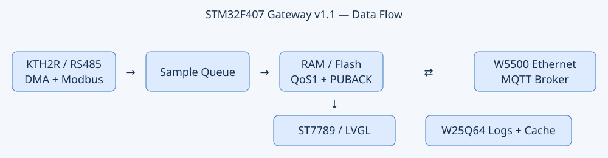

# STM32F407 环境采集网关

**RS485 采集 → LVGL 本地显示 → MQTT 上报 → 断网缓存与恢复补传**

版本：**1.1.1** · [更新记录](CHANGELOG.md) · [发布前验证](docs/发布验证.md) · [自动构建](https://github.com/gao0612/stm32-environment-gateway/actions)



一个用于学习记录、演示和求职展示的嵌入式项目：采集 RS485 温湿度数据，在小屏显示，并通过有线网络上报 MQTT。网络断开时将数据存入外部 Flash，恢复连接后按顺序补传。

本项目有参考 [zgd 的网关 V2.0](https://github.com/zgd-dev/-V2.0) 的功能方案，进而在自己想法下自主设计。
## 项目看点

| 部分 | 实现内容 | 阅读入口 |
| --- | --- | --- |
| 传感器采集 | DMA + IDLE、Modbus 校验、离线判断、接收故障恢复 | [采集任务](App/Tasks/sensor_task.c) |
| 网络上报 | W5500、MQTT QoS1、确认后释放、断线退避 | [网络任务](App/Tasks/network_task.c) |
| 断网缓存 | W25Q64、CRC + 提交标志、重启扫描、历史数据优先补传 | [日志与缓存](App/Storage/flash_store.c) |
| 本地交互 | ST7789、LVGL、DMA 双缓冲、按键切页、日志诊断 | [界面](App/UI/screen_ui.c) |
| 异常处理 | 任务心跳、集中喂狗、复位原因记录、片内 Flash A/B 参数 | [任务监控](App/Tasks/task_health.c) |

硬件：**STM32F407ZGT6 + KTH2R/MAX3485 + W5500 + W25Q64 + 1.54 寸 ST7789（240×240）**。不是 触摸屏。

## 先看这里

- **配置入口：根目录 `gateway.ioc`；[安全生成与工程维护](docs/CubeMX生成与工程维护.md)。**
- VS Code运行任务 `Regenerate and Build` 可重新生成并编译。

- [接线和上电](docs/接线.md)：实际引脚、电源和模块差异。
- [1.1实现与取舍](docs/版本1.1说明.md)：RAM/Flash策略、退避、日志和诊断。
- [测试参考与实际验收](docs/开源测试参考与本机验收.md)：来源区分、步骤、记录工具。
- [GitHub展示](docs/GitHub展示.md)：CI、照片视频和发布检查。
- [代码阅读顺序](docs/代码导读.md)：每个文件做什么、任务怎样配合。
- [配置与运行](docs/运行.md)：编译下载、MQTT 配置和按键用法。
- [验证记录](docs/测试.md)：本机自动测试结果与新版本上板验收表。
- [与原项目的区别](docs/来源与差异.md)：参考来源、许可证和适配范围。

## 已写入的功能

- USART3 循环 DMA + IDLE 接收、环形缓冲、Modbus RTU CRC16/异常帧处理、KTH2R 温湿度解析。
- UART 接收故障恢复、设备离线判断、数据新鲜度检查、队列传递完整采集结果。
- ST7789 + LVGL：温湿度页、设备状态页、日志与独立诊断页、SPI DMA 双缓冲刷新、按键切页。
- W5500 静态 IPv4、TCP 重连、MQTT 3.1.1 CONNECT/SUBSCRIBE/PUBLISH/PING，QoS1 发布确认。
- W25Q64：4MB循环日志、4MB持久化发送队列；CRC、提交标志、重启扫描恢复、确认后逻辑删除。
- 片内 Flash A/B 参数区、版本检查、CRC、写入后读回校验、保留旧参数。
- 关键任务心跳集中监控、IWDG、启动复位原因记录、调试故障注入开关。
- 30秒无按键自动关闭背光，按键或远程 `next` 唤醒；采集和上传继续运行。

## 文件结构

```text
App/
  Config/      网络示例配置、故障测试开关
  Tasks/       采集、转发、显示、按键、网络、健康监控任务
  Drivers/     ST7789、W5500、W25Q64、微秒时钟、看门狗
  Protocol/    Modbus、KTH2R、MQTT 报文
  Storage/     参数、片内Flash、外部Flash日志和缓存
  Data/        快照队列和设备健康状态
  UI/          LVGL接入和四个页面
Core/          启动、时钟、GPIO/DMA/串口/SPI、中断
Drivers/       ST HAL 与 CMSIS（保留上游代码）
Middlewares/   FreeRTOS 与 LVGL（保留上游代码）
ioLibrary_Driver/ WIZnet 官方驱动
docs/          接线、使用、代码说明和测试记录
tests/         可在电脑运行的协议/存储测试
```

## 快速编译

安装 GNU Arm Embedded GCC、CMake 3.22+、Ninja，加入 PATH。在工程目录运行：

```powershell
cmake --preset Debug
cmake --build --preset Debug
```

输出 `build/Debug/gateway_f407.elf`。VS Code 的 STM32 调试配置位于 `.vscode/launch.json`。Release：将上面 `Debug` 改为 `Release`。

首次联网前，复制 `App/Config/secrets.example.h` 为 `secrets.h` 并填写服务器地址；静态网络地址在 `App/Storage/app_params.c`。已保存的片内参数优先于默认值，详见运行文档。

## 适用范围

这是简化的可阅读实现：静态 IPv4、单个 MQTT 连接、固定主题、512字节最大接收报文，不包含 TLS、DNS、DHCP 或通用文件系统。背光关闭属于显示节能，不是 MCU STOP 低功耗模式。

每条缓存64字节，4MB约可容纳65536条，一秒一条约18.2小时。缓存满时拒绝新增并增加错误计数，不覆盖未确认数据。采集至缓存之前存在有限的RAM队列，瞬时断电或队列溢出可能损失尚未落盘的消息。

QoS1可能重复送达，新消息服务器应按 `device + boot + tick + sample` 去重；旧版缓存兼容规则见1.1说明。`tick` 是该次开机内的毫秒计数，非日历时间。FLASH写入寿命和实际运行时间必须结合你的采样周期实测。

## 版本验证

2026-11-17 发布前检查：**Debug / Release 固件构建通过，电脑端协议、存储、网络与启动检查通过**，见 [发布验证](docs/发布验证.md)。GitHub Actions 的线上执行状态请查看上方链接。

此前在开发板上做过全部功能实现；本仓库经过重新整理和改写。由于精力原因，本项目未做工业认证或者 7×24 小时可靠性验收。

## 在电脑上运行测试

安装 Python 3 和电脑端 GCC（不是 `arm-none-eabi-gcc`），运行：

```powershell
python tests/run_tests.py
```

测试覆盖缓存持久化、CRC 损坏、提交中断、满缓存保护、QoS1 确认、分包/合包、重连退避与启动入口检查。模拟测试不能替代真实 SPI、板卡供电和完整系统时序测试。

应用整理与新增代码采用 MIT；第三方组件按各自许可证，见 [第三方说明](THIRD_PARTY.md)。
